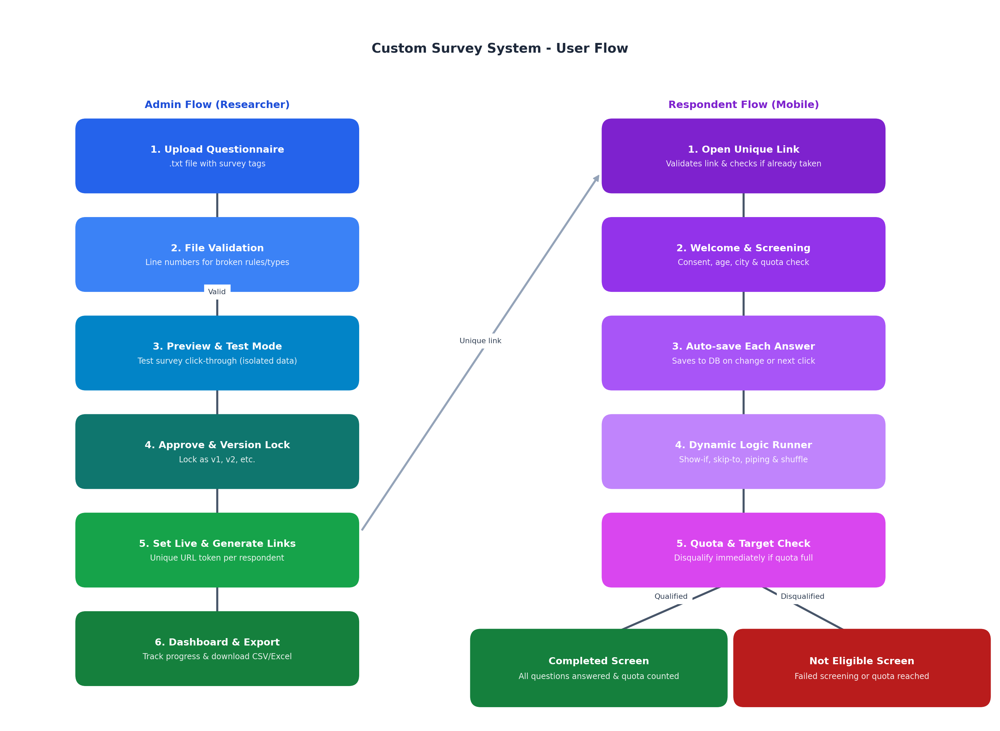
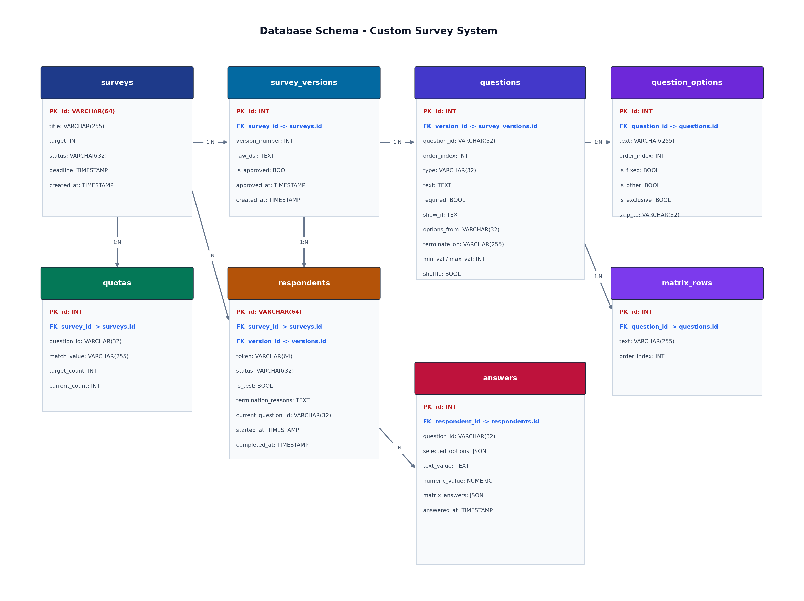

# Day 2 Milestone: Design & Architecture

This folder contains the Day 2 design deliverables:
1. **User Flow:** How researchers and respondents interact with the system.
2. **Database Schema:** Tables and relationships for storing surveys, questions, logic, and answers.

---

## Files

- **`user_flow.md`**: Complete user flow breakdown with Mermaid diagram.
- **`user_flow.png`**: Visual diagram of the user flow.
- **`schema.md`**: Database schema with table structures, fields, and explanation of design decisions.
- **`database_diagram.png`**: Visual diagram of the database tables and connections.

---

## Previews

### User Flow

### Database Schema

