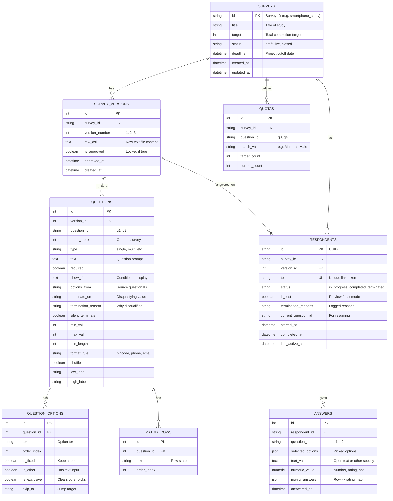

# Database Schema & Structure

This document describes the database design for the custom survey system. The schema is built using standard relational tables (SQLite for local development, easily portable to PostgreSQL).

---

## 1. Entity Relationship (ER) Diagram

---

## 2. Table Descriptions

### `surveys`
Keeps high-level survey information.
- `id` (VARCHAR PK): Survey identifier from tag (e.g., `smartphone_study`).
- `title` (VARCHAR): Display name.
- `target` (INTEGER): Total target number of completed surveys.
- `status` (VARCHAR): `draft`, `live`, or `closed`.
- `deadline` (DATETIME): Project deadline.
- `created_at`, `updated_at` (DATETIME): Timestamps.

### `survey_versions`
Freezes questionnaire definitions when approved so changes don't break existing responses.
- `id` (INTEGER PK AUTOINCREMENT)
- `survey_id` (VARCHAR FK -> `surveys.id`)
- `version_number` (INTEGER): 1, 2, etc.
- `raw_dsl` (TEXT): The uploaded `.txt` file contents.
- `is_approved` (BOOLEAN): True when ready for live fielding.
- `approved_at`, `created_at` (DATETIME)

### `questions`
Stores every parsed question for a specific version.
- `id` (INTEGER PK AUTOINCREMENT)
- `version_id` (INTEGER FK -> `survey_versions.id`)
- `question_id` (VARCHAR): Tag ID like `q1`, `q2`.
- `order_index` (INTEGER): Sequence order.
- `type` (VARCHAR): `single`, `multi`, `dropdown`, `yesno`, `rating`, `nps`, `matrix`, `text`, `longtext`, `number`, `formatted`, `info`, `consent`.
- `text` (TEXT): Question prompt.
- `required` (BOOLEAN): Whether it can be left blank.
- `show_if` (TEXT): Conditional logic (e.g., `q12=Yes AND q4=Mumbai`).
- `options_from` (VARCHAR): Question ID to pull selected options from.
- `terminate_on` (VARCHAR): Disqualifying answer.
- `termination_reason` (VARCHAR): Audit note for termination.
- `silent_terminate` (BOOLEAN): Politely end without stating disqualification.
- `min_val`, `max_val` (INTEGER): Min/max for numbers or ratings, or max picks for multi-select.
- `min_length` (INTEGER): Character limit for text fields.
- `format_rule` (VARCHAR): Validation type (`pincode`, `phone`, `email`).
- `shuffle` (BOOLEAN): Whether to randomize options.
- `low_label`, `high_label` (VARCHAR): Rating scale labels.

### `question_options`
Options defined for choice questions.
- `id` (INTEGER PK AUTOINCREMENT)
- `question_id` (INTEGER FK -> `questions.id`)
- `text` (VARCHAR): The choice label.
- `order_index` (INTEGER): Original position.
- `is_fixed` (BOOLEAN): If true, stays at the bottom when shuffled.
- `is_other` (BOOLEAN): If true, displays a text field for "Other (specify)".
- `is_exclusive` (BOOLEAN): If true ("None of these"), unchecks other picks.
- `skip_to` (VARCHAR): Question ID to jump to if chosen.

### `matrix_rows`
Statements evaluated in matrix questions.
- `id` (INTEGER PK AUTOINCREMENT)
- `question_id` (INTEGER FK -> `questions.id`)
- `text` (VARCHAR): Row text (e.g., "The battery lasts a full day").
- `order_index` (INTEGER): Row position.

### `quotas`
Fulfillment goals per answer.
- `id` (INTEGER PK AUTOINCREMENT)
- `survey_id` (VARCHAR FK -> `surveys.id`)
- `question_id` (VARCHAR): Question checked (e.g., `q3`).
- `match_value` (VARCHAR): Answer value (e.g., `Mumbai`).
- `target_count` (INTEGER): Target cap.
- `current_count` (INTEGER): Number of completed responses matching this value.

### `respondents`
Tracks each person's survey session.
- `id` (VARCHAR PK): UUID.
- `survey_id` (VARCHAR FK -> `surveys.id`)
- `version_id` (INTEGER FK -> `survey_versions.id`): Locks the user to the version they started on.
- `token` (VARCHAR UNIQUE): Token passed in the URL.
- `status` (VARCHAR): `in_progress`, `completed`, or `terminated`.
- `is_test` (BOOLEAN): True if generated during admin preview.
- `termination_reasons` (TEXT): Logged reasons (e.g., `q5: Not a smartphone user`).
- `current_question_id` (VARCHAR): Last question reached, for resuming.
- `started_at`, `completed_at`, `last_active_at` (DATETIME)

### `answers`
Saved responses for every question.
- `id` (INTEGER PK AUTOINCREMENT)
- `respondent_id` (VARCHAR FK -> `respondents.id`)
- `question_id` (VARCHAR): Question ID (e.g., `q1`).
- `selected_options` (JSON): Selected choices for single/multi.
- `text_value` (TEXT): Text inputs, pincode, or "Other" text.
- `numeric_value` (NUMERIC): Numbers, ratings, NPS scores.
- `matrix_answers` (JSON): Map of `{ "statement": "rating" }`.
- `answered_at` (DATETIME): Time the answer was saved.

---

## 3. Key Design Decisions

### In-Progress Responses When Version Changes
- When a respondent starts a survey, their session is linked directly to that specific `version_id`.
- If an admin uploads and approves Version 2 while someone is half-way through Version 1, they finish on Version 1 without interruption or broken questions.
- When exporting, the `version` column clearly indicates which version the respondent completed.

### In-Progress Responses When Survey Closes
- When a survey closes (total target reached or deadline passed), active respondents are allowed to finish as long as quota slots remain.
- If the final quota slot fills up before they click submit, the submission fails the quota check gracefully and shows the Survey Closed screen.
- In-progress answers are retained in the database so researchers can review drop-off points, but they are not marked as completed.
