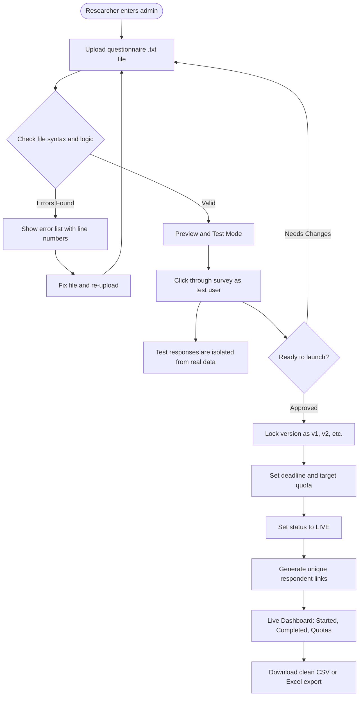
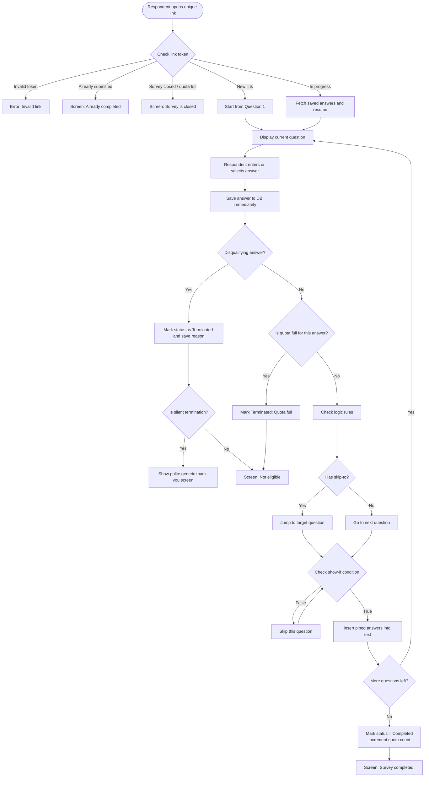

# User Flow & Screen Design

This document outlines the user flow for both researchers (admin) and survey respondents for the Concave Insights survey system.

---

## 1. Overview of the Flow

There are two main parts to the application:
1. **Admin / Researcher Side:** Uploading questionnaire files, reviewing validation errors, previewing surveys, making them live, and exporting data.
2. **Respondent Side (Mobile-First):** Opening a unique link, going through questions with logic/piping, auto-saving each answer, and reaching a completion or termination screen.

```
[ Researcher ]                                        [ Respondent ]
      │                                                     │
Upload .txt file                                      Open unique link
      │                                                     │
Check for errors (with line numbers)                  Answer screening questions
      │                                                     │
Preview & Test (isolated)                             Answers saved on each step
      │                                                     │
Approve & Publish (locked as v1/v2)                   Skip/Piping/Quotas applied
      │                                                     │
Track live stats & download export                    End screen (Completed / Closed / Disqualified)
```

---

## 2. Researcher / Admin User Flow



### Steps Explained:
- **Upload:** The researcher uploads a plain `.txt` file containing the survey structure.
- **Validation:** The parser scans line by line. If there is a problem (like an unknown question type, a duplicate question ID, or a skip rule pointing to a non-existent question), it displays the exact line number and what is wrong so the researcher can fix it quickly.
- **Preview & Test:** The researcher can click through the survey to verify skip logic, piping, and option shuffle. Test responses have an `is_test = true` flag so they do not affect live quotas or get included in client data exports.
- **Approval & Versioning:** When approved, the questionnaire is locked as a version (e.g., v1). If updates are uploaded later, they become v2, protecting existing respondent data.
- **Dashboard & Export:** Shows live counts for completed, in-progress, and terminated responses, plus quota fulfillment. Data exports directly into the required CSV/Excel layout.

---

## 3. Respondent User Flow (Mobile)



---

## 4. How Key Edge Cases Are Handled

- **Phone battery dies or tab is closed:** Because every answer is saved as soon as it is selected, when the respondent opens the link again, the app fetches their previous answers and resumes at the next unanswered question.
- **Back button navigation:** The user can tap Back to review or change an earlier answer. If an answer changes, any subsequent questions affected by skip or show-if logic are re-evaluated.
- **Double submissions:** Each participant gets a unique link. Once submitted, reopening that link shows an "Already completed" message.
- **Survey closes while someone is taking it:** If the total target or quota fills up while someone is midway through, the system checks quota availability before completing the response and politely routes them to the Survey Closed screen.
- **Silent termination:** If a question has `silent="true"`, disqualified users see a polite thank-you message instead of a rejection screen, but their status is saved internally as terminated with the reason.

---

## 5. Main Screens Summary

1. **Welcome / Consent Screen:** Brief intro text, consent question with agree/decline.
2. **Screening Questions:** City, age, phone usage. Checks termination conditions and quotas early.
3. **Core Survey Questions:** Dynamic questions with piping, max selection limits, rating scales, and matrix tables.
4. **End Screens:**
   - **Completed:** "Thank you! Your responses have been saved."
   - **Not Eligible:** "Thank you for your interest. You do not meet the criteria for this survey."
   - **Survey Closed:** "This study has reached its response limit and is now closed."
   - **Already Completed:** "You have already completed this survey."
